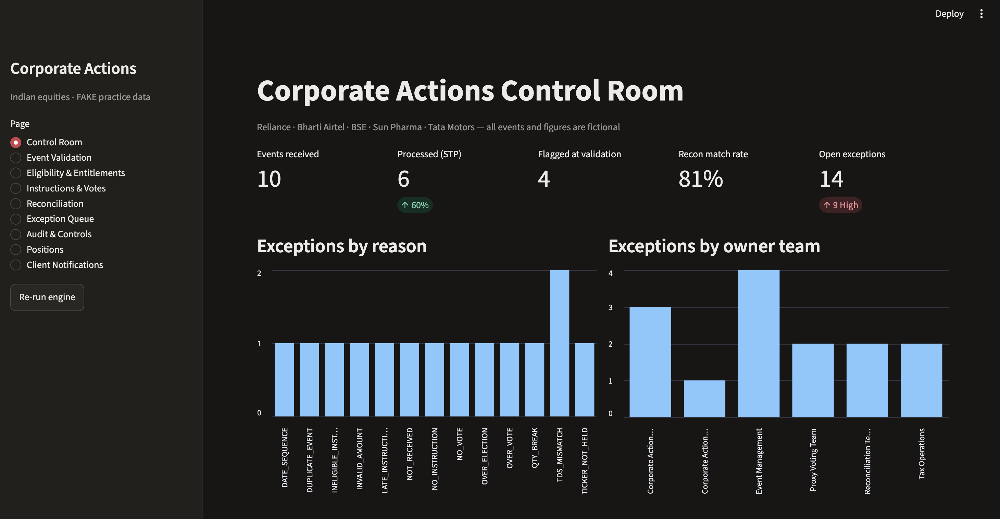
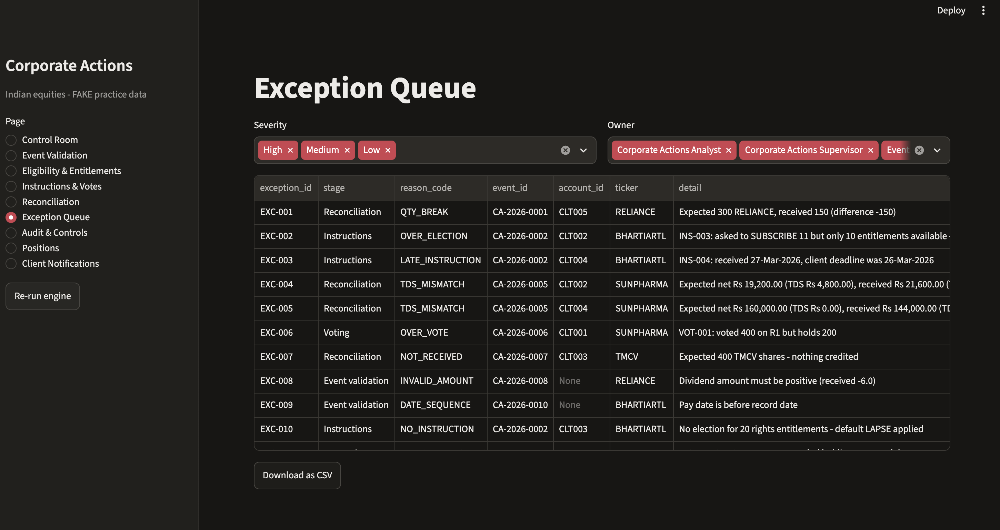
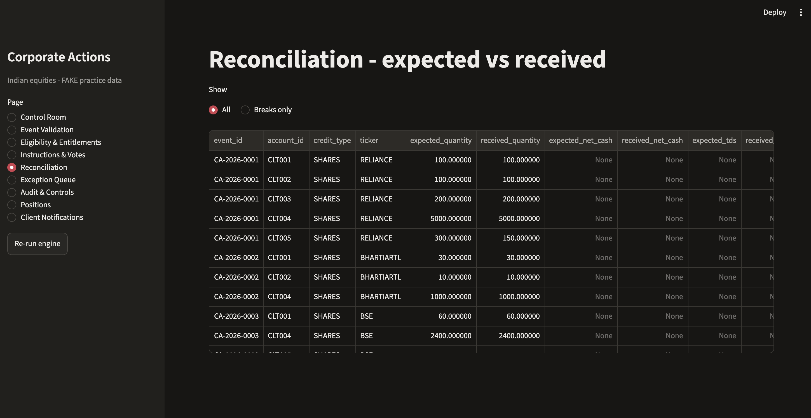

# Indian Corporate Actions Processing Engine

An end-to-end corporate actions processing engine for Indian equities, modelled on the daily workflow of an
**Asset Servicing / Corporate Actions** operations team.

The engine validates an incoming corporate actions feed, determines eligible holders from settled positions on the
record date, calculates entitlements, processes client elections and proxy votes, reconciles expected entitlements
against depository and registrar credits, and routes every discrepancy to a prioritised exception queue with an
owner, SLA and required action.


**Tech stack:** Python · pandas · NumPy · openpyxl · Streamlit · pytest · GitHub Actions



---

## Key features

| Area | Capability |
|---|---|
| **Event validation** | Checks every vendor event before processing: supported event type, required fields, duplicate events from multiple vendors, positive amounts and ratios, date sequencing, cost apportionment totalling 100%, and whether any client holds the security |
| **Record-date eligibility** | Determines entitlement from **settled** holdings under the **T+1** settlement cycle. A purchase on the record date is not eligible; a sale on the record date retains the entitlement |
| **Mandatory events** | Bonus issues, cash dividends with **TDS** by client tax status, demergers with **cost-of-acquisition apportionment** |
| **Voluntary events** | Rights issues (subscribe / renounce / lapse, with default lapse) and AGM e-voting |
| **Instruction management** | Detects over-elections, late instructions, instructions from ineligible holders and missing instructions |
| **Proxy voting** | Caps votes at the eligible holding on the cut-off date and flags non-voting holders |
| **Reconciliation** | Compares expected entitlements with depository/registrar credits: share shortfalls, missing credits and incorrect TDS deductions |
| **Exception management** | Each exception carries a reason code, severity, owner team, SLA due date and required action |
| **Controls** | Cost-basis preservation, full cost explanation, no over-processing of elections or votes, complete reconciliation coverage |
| **Reporting** | 13-sheet Excel report, client notifications per event and account, and an interactive Streamlit control dashboard |

---

## Test scenario

I designed a synthetic dataset covering five Indian large-cap stocks — Reliance Industries, Bharti Airtel, BSE,
Sun Pharmaceutical and Tata Motors — to exercise every processing rule and control. Events, dates, prices, client
accounts and amounts are simulated and do not represent actual corporate announcements.

### Client accounts

| Account | Client type | Processing consideration |
|---|---|---|
| CLT001 | Resident individual | Dividend below the TDS threshold |
| CLT002 | Resident individual, PAN not on file | Higher TDS rate (20%) |
| CLT003 | Non-resident | 20% TDS with no threshold |
| CLT004 | Mutual fund | TDS exempt |
| CLT005 | Resident company | Standard 10% TDS |

### Corporate actions feed

| Event | Security | Event type | ISO 15022 | Outcome |
|---|---|---|---|---|
| CA-2026-0001 | RELIANCE | 1:1 bonus issue | BONU | Processed |
| CA-2026-0002 | BHARTIARTL | 1:14 rights issue at ₹1,200 | RHDI/EXRI | Processed with client elections |
| CA-2026-0003 | BSE | 2:1 bonus issue | BONU | Processed |
| CA-2026-0004 | BSE | Same bonus received from a second vendor | BONU | **Flagged – duplicate event** |
| CA-2026-0005 | SUNPHARMA | ₹8 final dividend | DVCA | Processed with TDS |
| CA-2026-0006 | SUNPHARMA | AGM e-voting, 3 resolutions | MEET | Processed with client votes |
| CA-2026-0007 | TATAMOTORS | 1:1 demerger into TMCV, 65/35 cost split | SOFF | Processed |
| CA-2026-0008 | RELIANCE | Dividend received with a negative amount | DVCA | **Flagged – invalid amount** |
| CA-2026-0009 | INFY | Dividend on a security with no client holdings | DVCA | **Flagged – not held** |
| CA-2026-0010 | BHARTIARTL | Pay date before record date | DVCA | **Flagged – date sequence** |

### Exception scenarios built into the data

- **Settlement timing:** trades placed the day before, on, and after record dates to test T+1 eligibility
- **Over-election:** a client elects 11 rights shares against an entitlement of 10 (150 ÷ 14 = 10.71, fraction dropped)
- **Late instruction:** a rights election received after the client deadline but before the market deadline
- **Ineligible instruction:** an election from a client whose purchase settled after the record date
- **Missing instruction:** no election received — default lapse applied
- **Over-voting:** a client votes 400 shares while holding 200 on the cut-off date
- **Short credit:** depository credits 150 bonus shares against an entitlement of 300
- **Incorrect TDS:** registrar applies 10% to a client without PAN (should be 20%) and to a TDS-exempt mutual fund
- **Missing credit:** demerger shares not credited to one account

### Results

| Metric | Result |
|---|---|
| Events received / processed / flagged | 10 / 6 / 4 |
| Straight-through processing (STP) rate | 60% |
| Expected credits / matched / breaks | 21 / 17 / 4 (81% match rate) |
| Exceptions raised | 14 (9 High, 3 Medium, 2 Low) |
| Control checks | 8 of 8 passed |
| Automated tests | 24 of 24 passed |

---

## Processing workflow

```
Corporate actions feed
        │
        ▼
1. EVENT VALIDATION ───────── invalid event ─────────────┐
        │ valid events (in record-date order)              │
        ▼                                                  │
2. ELIGIBILITY        apply trades settled by record date  │
        │             (T+1) → eligible holders             │
        ▼                                                  ▼
3. PROCESSING         bonus · dividend + TDS · demerger    EXCEPTION QUEUE
        │             rights + client elections ── issue ─▶ reason code · severity
        │             AGM + client votes                    owner · SLA due date
        ▼                                                   required action
4. RECONCILIATION     expected vs depository credits ─ break ─▶
        │
        ▼
5. CONTROLS · AUDIT LOG · CLIENT NOTIFICATIONS · EXCEL REPORT · DASHBOARD
```

### Processing rules (worked examples from the dataset)

| Event | Rule | Example |
|---|---|---|
| **Bonus** | Shares increase; total cost unchanged; cost per share falls | CLT004 BSE: 1,200 + 2,400 bonus = 3,600 shares; cost per share ₹2,200 → ₹733.33 |
| **Cash dividend** | Gross = shares × rate; TDS by tax status; net credited | CLT002 Sun Pharma: 3,000 × ₹8 = ₹24,000; no PAN → 20% TDS ₹4,800; net ₹19,200 |
| **Demerger** | New shares created; original cost apportioned by issuer ratio | CLT001: 250 TATAMOTORS (₹1,75,000) → 250 TATAMOTORS at 65% (₹1,13,750) + 250 TMCV at 35% (₹61,250) |
| **Rights issue** | Entitlement = holding ÷ ratio, fractions dropped; client elects; unused rights lapse | CLT001: 700 ÷ 14 = 50 rights → subscribes 30 (₹36,000), renounces 20 |
| **Cost control** | Opening cost + trades + rights subscriptions = final book cost | Verified to the paisa on every run |

---

## Testing

The project includes **24 automated tests** (pytest), each verifying one business rule. Tests run automatically
on every push through GitHub Actions.

**Result: 24 passed, 0 failed**

| Area | What is tested | Tests | Result |
|---|---|:---:|:---:|
| **Settlement & eligibility** | T+1 settlement skips weekends | 1 | ✅ Pass |
| | Purchase on record date is not eligible | 1 | ✅ Pass |
| | Purchase the day before record date is eligible | 1 | ✅ Pass |
| | Sale on record date retains the entitlement | 1 | ✅ Pass |
| **Entitlement calculation** | Rights fraction dropped (150 ÷ 14 = 10 rights) | 1 | ✅ Pass |
| | 2:1 bonus calculated correctly (1,200 → 2,400 bonus) | 1 | ✅ Pass |
| | Demerger cost split preserves total cost (65% / 35%) | 1 | ✅ Pass |
| **Dividend TDS** | Resident below threshold → 0% · No PAN → 20% · Non-resident → 20% · Mutual fund → exempt · Company → 10% | 5 | ✅ Pass |
| **Event validation** | Duplicate event · negative amount · security not held · pay date before record date | 4 | ✅ Pass |
| | Duplicate bonus is not applied twice | 1 | ✅ Pass |
| **Instructions & voting** | Over-election capped at entitlement | 1 | ✅ Pass |
| | Over-vote capped at eligible holding | 1 | ✅ Pass |
| **Reconciliation** | Short share credit · incorrect TDS (×2) · missing demerger credit | 4 | ✅ Pass |
| **Controls** | All 8 control checks pass | 1 | ✅ Pass |
| **Total** | | **24** | **✅ 24 passed** |

<details>
<summary>Full test output</summary>

```
$ python -m pytest -v

test_t_plus_1_settlement_skips_weekend PASSED
test_buy_on_record_date_is_not_eligible PASSED
test_buy_day_before_record_date_is_eligible PASSED
test_sell_on_record_date_keeps_entitlement PASSED
test_rights_fraction_is_dropped PASSED
test_bonus_2_for_1 PASSED
test_demerger_cost_split_preserves_total PASSED
test_dividend_tds[RESIDENT_INDIVIDUAL-Y-1600-0] PASSED
test_dividend_tds[RESIDENT_INDIVIDUAL-N-24000-4800] PASSED
test_dividend_tds[NON_RESIDENT-Y-4000-800] PASSED
test_dividend_tds[MUTUAL_FUND-Y-160000-0] PASSED
test_dividend_tds[RESIDENT_COMPANY-Y-20000-2000] PASSED
test_bad_events_are_flagged[CA-2026-0004-DUPLICATE_EVENT] PASSED
test_bad_events_are_flagged[CA-2026-0008-INVALID_AMOUNT] PASSED
test_bad_events_are_flagged[CA-2026-0009-TICKER_NOT_HELD] PASSED
test_bad_events_are_flagged[CA-2026-0010-DATE_SEQUENCE] PASSED
test_duplicate_bonus_not_applied_twice PASSED
test_over_election_is_capped PASSED
test_over_vote_is_capped PASSED
test_recon_breaks_found[CA-2026-0001-CLT005-QTY_BREAK] PASSED
test_recon_breaks_found[CA-2026-0005-CLT002-TDS_MISMATCH] PASSED
test_recon_breaks_found[CA-2026-0005-CLT004-TDS_MISMATCH] PASSED
test_recon_breaks_found[CA-2026-0007-CLT003-NOT_RECEIVED] PASSED
test_all_controls_pass PASSED

============================== 24 passed ==============================
```
</details>

---

## Dashboard

The Streamlit control dashboard provides nine views: Control Room, Event Validation, Eligibility & Entitlements,
Instructions & Votes, Reconciliation, Exception Queue, Audit & Controls, Positions, and Client Notifications.

| Exception Queue | Reconciliation |
|---|---|
|  |  |

---

## Project structure

```
india-corporate-actions-engine/
├── data/                         input files
│   ├── accounts.csv              client accounts and tax status
│   ├── securities.csv            security master
│   ├── opening_positions.csv     opening holdings
│   ├── trades.csv                trades around record dates
│   ├── events_feed.csv           vendor corporate actions feed
│   ├── client_instructions.csv   rights elections and AGM votes
│   └── depository_credits.csv    depository and registrar credits
├── ca_engine/
│   ├── config.py                 business rules: TDS, tolerances, exception catalogue
│   ├── validation.py             event validation
│   ├── position_book.py          settled holdings and cost basis
│   ├── processors.py             event processing, one function per event type
│   ├── tax.py                    dividend TDS
│   ├── reconciliation.py         expected vs received
│   ├── exceptions.py             exception records
│   ├── notifications.py          client notifications
│   ├── reporting.py              Excel and CSV reporting
│   └── pipeline.py               orchestration, controls and KPIs
├── tests/test_engine.py          24 automated tests, one per business rule
├── .github/workflows/tests.yml   runs the tests automatically on every push
├── screenshots/                  dashboard screenshots
├── app.py                        Streamlit dashboard
└── run.py                        command-line run
```

---

## Getting started

```bash
python3 -m venv .venv
source .venv/bin/activate          # Windows: .venv\Scripts\activate
pip install -r requirements.txt

python run.py                      # run the engine and print a summary
python -m pytest -q                # run the test suite
streamlit run app.py               # launch the dashboard at http://localhost:8501
```

### Outputs

- `outputs/corporate_actions_report.xlsx` — Summary, Event Validation, Eligibility, Entitlements, Instructions,
  Votes, Cash Ledger, Reconciliation, Exceptions, Audit Log, Controls, Opening and Final Positions
- `outputs/notifications/` — one client notification per event and account
- `outputs/csv/` — every output table in CSV format

---

## Design assumptions

- Business days exclude weekends only; a production system would use the NSE trading-holiday calendar.
- Ex-date equals record date, consistent with T+1 settlement in India. Entitlements are booked at processing time
  rather than on the allotment date.
- TDS logic is simplified: the threshold is applied per event, and surcharge, cess and treaty rates are excluded.
- Rights shares are fully paid; renounced entitlements are not valued; fractional entitlements are dropped.
- Bonus cost is spread across all shares (portfolio accounting view). For Indian income-tax purposes, bonus shares
  carry a nil cost of acquisition.

## Roadmap

- Fixed income events: coupons, redemptions and calls
- Partly-paid rights issues and call-money processing
- SLA ageing and breach reporting
- ISO 15022 MT564 / MT565 / MT566 message parsing
- NSE trading-holiday calendar
- Database storage and user-uploaded event files

---

## Acknowledgements

The overall workflow design (validation → processing → exception queue → reconciliation → dashboard) was inspired by
[ludmila-abd/corporate-actions-simulator](https://github.com/ludmila-abd/corporate-actions-simulator).
This project is an independent implementation for the Indian market, extending the concept with record-date
settlement eligibility, multi-account processing, TDS, rights elections, AGM voting, depository reconciliation and
client notifications.